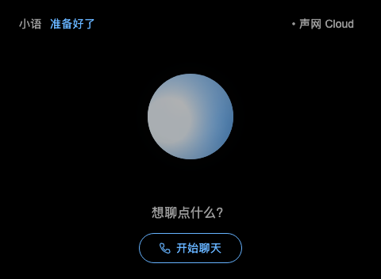

# Agora AIUI SDK

**Give your AIUI Agent a voice people can talk to.**

[](https://github.com/yodaos-project/agora-aiui-sdk/actions/workflows/check.yml)
[](LICENSE)

English · [简体中文](README.zh-CN.md)

[Get started](docs/getting-started.md) · [Try the example](examples/agent) · [API reference](docs/api.md)

## What is a Voice Agent?

A Voice Agent is an AI assistant you can speak with. It listens to your question,
understands what you mean, and answers aloud. With interruptions enabled, you can
speak while it is answering and guide the conversation in a new direction.

Voice keeps your hands free and lets you focus on what you are doing. It works
well for AI glasses, language practice, interactive guides, and step-by-step help.

**Agora AIUI SDK** brings these conversations to AIUI Agents running on
[Ink](https://github.com/jsar-project/ink). Your AIUI Agent captures speech and
plays replies; Agora or Shengwang Cloud provides speech recognition, the language model, and
the AI's voice. Configure its personality, language, and voice in Agora Agent Studio.

## What you can build

| Use case             | Try saying…                           |
| -------------------- | ------------------------------------- |
| AI glasses assistant | “Tell me what to do next.”            |
| Language practice    | “Help me practice ordering a coffee.” |
| Interactive guide    | “Tell me more about this exhibit.”    |
| Product onboarding   | “Walk me through setting this up.”    |

## A conversation, ready to adapt

The included example is a compact voice companion designed for color and
green-only glasses displays. Choose `agora` for English and **Agora Cloud**,
or `shengwang` for Chinese and **声网 Cloud**, in the example configuration.

<table>
  <tr>
    <td></td>
    <td></td>
  </tr>
  <tr>
    <td align="center">Agora · English</td>
    <td align="center">声网 · 中文</td>
  </tr>
</table>

Screenshots captured from the example in ink-open at the glasses display size (480 × 352).

- **Speak naturally.** Two-way audio with microphone and speaker controls.
- **Interrupt the reply.** Full-duplex conversation on hosts with echo cancellation or with headphones.
- **See what was heard.** Your latest recognized speech updates in a single line.
- **Follow the conversation.** An animated orb shows listening, thinking, speaking, and confirmed interruptions.
- **Let the AI act.** [Define local tools](docs/local-tools.md) to change the interface or end a call; execute functions stay in your AIUI Agent.
- **Keep the interface responsive.** Native Ink processes real-time text in an Agent Worker, separately from page animation and audio.

The SDK also exposes AI reply text, audio levels, connection states, and volume
controls for your own interface. The example keeps AI reply text off the screen.

Audio uses Ink's WHIP and WebRTC APIs. Live text uses the official Agora RTM SDK,
loaded by the example's Worker. JavaScript modules and TypeScript declarations are included.

## Run your first conversation

You will need:

- Node.js 22+ and a recent Ink host with microphone, WHIP, and Worker networking support.
- An Agora or Shengwang project enabled for duplex WHIP and Signaling (RTM).
- A published voice agent in AI Studio and its `pipelineId`.

```sh
git clone https://github.com/yodaos-project/agora-aiui-sdk.git
cd agora-aiui-sdk
npm ci
npm run example:prepare
```

Follow the **[getting started guide](docs/getting-started.md)** from account registration through project setup, agent publication, and the first call.

Start the configured backend in one terminal:

```sh
npm run example:server          # Agora
# or: npm run example:server:cn # Shengwang China
```

Open the example in another terminal:

```sh
ink-open examples/agent --networking-transport native --permission-checks --theme yodaos-sprite-color
```

Tap **Let’s talk**, allow the microphone, and ask a question. Try
interrupting a longer answer. Tap **End** when you are done.
Keep the AIUI Agent in the foreground; if playback pauses after switching windows,
tap **Resume**.

## Add voice to your AIUI Agent

For a project with an npm bundler:

```sh
npm install github:yodaos-project/agora-aiui-sdk
```

Ink resolves the SDK from the AIUI Agent’s own `node_modules`.
With your backend and application authentication configured:

```js
import { createAgoraVoiceSession, createHttpVoiceBackend } from '@yodaos-pkg/agora-aiui-sdk';
import configuration from './configuration.js';

const backend = createHttpVoiceBackend({
  baseURL: configuration.backendURL,
  authorization: configuration.authorization,
});
const voice = createAgoraVoiceSession({ backend });

// In your Start button handler:
await voice.start();

// In your End button or page unload handler:
await voice.stop();
```

Create a new session for each call. The [integration guide](docs/integration.md)
shows a complete page with lifecycle handling and audio controls. Use the
[example Worker](examples/agent/workers/transcripts.js) to add live text.

## How it works

| Piece                   | Responsibility                                              |
| ----------------------- | ----------------------------------------------------------- |
| Your AIUI Agent         | Capture speech, play replies, and present the conversation. |
| Your session backend    | Issue temporary credentials and start/stop the cloud AI.    |
| Agora / Shengwang Cloud | Transport audio and run your configured voice agent.        |

Audio travels directly between Ink and the selected cloud. The session backend handles
setup and cleanup. Use the included Node.js backend as a starting point, connect
your own service, or [use existing temporary credentials](docs/integration.md#use-existing-temporary-credentials)
when your system already manages the cloud AI.

**Keep App Certificates and model API keys on the server.** The reference backend
uses different string UIDs for the AIUI Agent and the cloud AI.

## Compatibility and verification

The macOS example has been tested with real Agora and Shengwang audio, live ASR, interruptions,
and repeated connect/stop cycles. The user confirmed fluent speech and interruptions;
Shengwang voice-controlled color and hangup were also verified. Measurements and host-specific results are in [verification notes](docs/validation.md#real-cloud-results).

Native Ink runs the RTM Worker on a separate thread. Ink Web currently shares its
browser event loop with the Worker realm; measure Web performance separately.
For hosts without echo cancellation, use headphones or [turn-taking mode](docs/api.md#take-turns-speaking).

This version focuses on foreground conversations. Automatic call reconnection,
background calling, general chat messaging, and word captions
synchronized to playback are outside the current API.

## Documentation

| I want to…                      | Read                                               |
| ------------------------------- | -------------------------------------------------- |
| Have my first conversation      | [Getting started](docs/getting-started.md)         |
| Add voice to an AIUI Agent      | [Integration guide](docs/integration.md)           |
| Set up Agora and authentication | [Backend guide](docs/backend.md)                   |
| Find a method or option         | [API reference](docs/api.md)                       |
| Fix a connection or audio issue | [Troubleshooting](docs/troubleshooting.md)         |
| Run tests or contribute         | [Development and verification](docs/validation.md) |

## Contribute

Questions, bugs, and ideas are welcome in [GitHub Issues](https://github.com/yodaos-project/agora-aiui-sdk/issues).
Include your Ink host, SDK version, and a short reproduction without credentials.

```sh
npm ci
npm run check
```

Licensed under the [MIT License](LICENSE). Cloud and model usage follows your provider plans.
